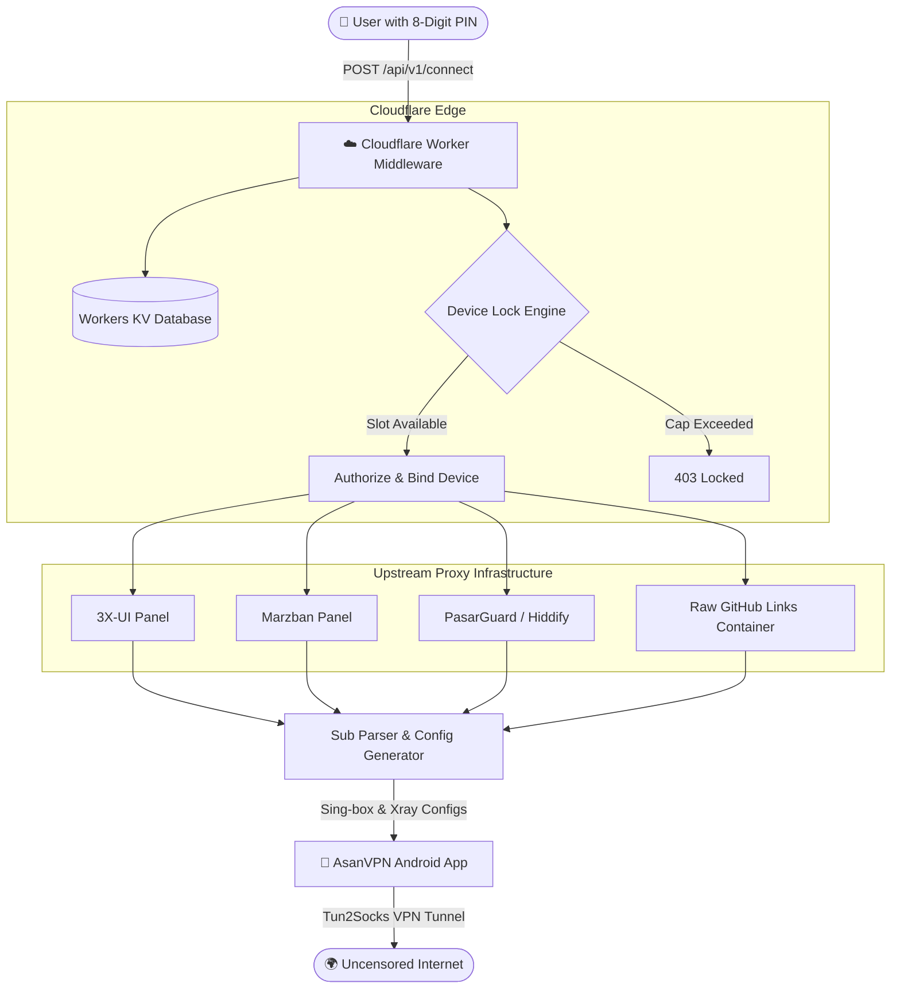

# AsanVPN (آسان وی‌پی‌ان) 🛡️🚀

> **Zero-Configuration, PIN-Based Multi-Panel Proxy Client & Cloudflare Serverless Middleware for Non-Technical Users and Families.**

[](https://developer.android.com/)
[](https://kotlinlang.org/)
[](https://developer.android.com/jetpack/compose)
[](https://workers.cloudflare.com/)
[](https://github.com/SagerNet/sing-box)
[](https://github.com/armanpier/AsanVPN/releases/latest)

---

## 📥 Download Official APKs (دانلود مستقیم)

The Android app is pre-configured to connect directly to the active Cloudflare Worker (`https://asanvpn-worker.hi-deploy.workers.dev`). Simply install, type your 8-digit PIN, and connect.

| Architecture | APK Download | File Size | Recommended For |
| :--- | :--- | :--- | :--- |
| **Universal (All CPUs) - Primary** | [⬇️ **Download Universal APK**](https://github.com/armanpier/AsanVPN/releases/download/v1.2.0/AsanVPN-v1.2.0-universal.apk) | **~69.8 MB** | **Guaranteed to work on ANY Android device without checking CPU type** |
| **arm64-v8a** | [⬇️ **Download arm64-v8a**](https://github.com/armanpier/AsanVPN/releases/download/v1.2.0/AsanVPN-v1.2.0-arm64-v8a.apk) | **~30.1 MB** | All modern Android phones (Samsung, Xiaomi, Pixel, Huawei, etc.) |
| **armeabi-v7a** | [⬇️ **Download armeabi-v7a**](https://github.com/armanpier/AsanVPN/releases/download/v1.2.0/AsanVPN-v1.2.0-armeabi-v7a.apk) | **~30.6 MB** | Older 32-bit Android phones, budget tablets, Android TV boxes & sticks |
| **x86_64** | [⬇️ **Download x86_64**](https://github.com/armanpier/AsanVPN/releases/download/v1.2.0/AsanVPN-v1.2.0-x86_64.apk) | **~31.1 MB** | 64-bit Android emulators (LDPlayer, BlueStacks, Nox, Android Studio) & Chromebooks |
| **x86** | [⬇️ **Download x86**](https://github.com/armanpier/AsanVPN/releases/download/v1.2.0/AsanVPN-v1.2.0-x86.apk) | **~31.6 MB** | Legacy 32-bit Intel x86 emulators |

> 🌐 **Live Web Admin Dashboard**: [`https://asanvpn-worker.hi-deploy.workers.dev/admin`](https://asanvpn-worker.hi-deploy.workers.dev/admin)

---

## 📖 Overview

In heavily filtered environments, traditional proxy clients (such as v2rayNG, Clash, and Hiddify) are notoriously overwhelming for seniors, parents, and non-technical users. They require copying long cryptic VLESS/VMess strings, manually refreshing configs, diagnosing broken nodes, and frequently contacting family members for troubleshooting.

**AsanVPN** solves this completely:
1. **Zero Configuration**: The user enters a single **8-digit PIN code** once.
2. **Instant Auto-Provisioning**: The Cloudflare Worker middleware authenticates the PIN, checks expiration & traffic, validates hardware device limits, fetches and combines nodes across multiple panels (Marzban, 3X-UI, PasarGuard, Hiddify, or GitHub raw links), and builds an optimized proxy routing configuration on the fly.
3. **One-Tap Connection**: The user presses one large button to connect. That's it!

---

## ✨ Key Features

### 📱 Android Application (`android/`)
- **Senior-Friendly Persian UI**: Built with **Jetpack Compose** and **Material 3**, with large fonts, Persian numerals, and high-contrast status indicators.
- **Hardware Lock Enforcement**: Automatically binds to unique hardware ID (`Settings.Secure.ANDROID_ID`) to prevent subscription leakage.
- **Real-Time Traffic & Expiry Display**: Shows remaining gigabytes and days left clearly on the main screen.
- **Resilient Fallback**: Automatically caches working nodes locally; if the management API is temporarily unreachable, connection still works seamlessly.
- **Multi-Core Architecture**: Supports both **Sing-box** and **Xray Core** configs (VLESS, VMess, Shadowsocks, Reality, Trojan).

### ⚡ Cloudflare Serverless Middleware (`backend/worker/`)
- **Edge Performance**: Deployed across 300+ global Cloudflare edge data centers with sub-millisecond response latency.
- **Hardware Device Lock (`DeviceLock`)**:
  - **Single Device (1)**: Strict 1-phone binding (default).
  - **Multi-Device Pool (N)**: Allows a specific number of phones (e.g. 2, 5, or **20 phones** for family or business accounts).
  - **Unlimited (0)**: Unlimited concurrent devices.
  - **Reset Lock**: Admin can instantly release all device bindings in 1 click.
- **Multi-Panel Aggregation**:
  - Connect a user to multiple upstream panels or GitHub raw containers simultaneously.
  - Merges configs, deduplicates identical usernames across servers, and automatically adopts the highest remaining traffic and latest expiry date.
- **Resilient Fallback Nodes**: Bootstrap Reality nodes guarantee client connection even if upstream panel APIs face intermittent downtime.
- **Brute-Force Rate Limiting**: 3 consecutive invalid PIN attempts triggers a strict 30-minute lockout on the device.
- **Direct APK CDN Hosting**: Streams compiled APK updates directly from Cloudflare Worker KV storage in chunks without external file hosters.

### 🖥️ Modern Web Admin Dashboard (`/admin`)
- Built-in lightweight, responsive Persian RTL dashboard with **Tailwind CSS** and **SweetAlert2**.
- Full CRUD for users: generate secure 8-digit PINs, adjust traffic, set days, configure multi-device limits (presets for 1, 2, 5, 20, or Unlimited).
- One-click bulk domain migration (`/api/v1/admin/migrate`): seamlessly migrates all user configs if a domain gets blocked.
- Secure admin authentication with changeable custom password.

---

## 🏗️ Architecture



---

## 🚀 Quick Start & Deployment

### 1. Cloudflare Worker Setup

1. **Clone repository and navigate to backend**:
   ```bash
   cd backend/worker
   npm install
   ```

2. **Authenticate with Cloudflare**:
   ```bash
   npx wrangler login
   ```

3. **Create KV Namespace**:
   ```bash
   npx wrangler kv namespace create VPN_USERS
   ```
   Copy the generated namespace `id` into `wrangler.toml`:
   ```toml
   [[kv_namespaces]]
   binding = "VPN_USERS"
   id = "your_kv_namespace_id_here"
   ```

4. **Deploy to Cloudflare**:
   ```bash
   npm run deploy
   ```

5. **Access Dashboard**:
   Open `https://your-worker.workers.dev/admin` in your browser.
   - Enter your configured `ADMIN_TOKEN` secret.
   - You can set and update your custom dashboard password in **Settings (تنظیمات)**.

---

### 2. Android App Compilation

1. **Open `android/` project in Android Studio** (Hedgehog / Iguana or later).
2. Set your Cloudflare Worker URL in `android/app/src/main/java/com/asanvpn/app/data/PreferencesManager.kt` or `VpnRepository.kt`:
   ```kotlin
   const val BASE_URL = "https://your-worker.workers.dev"
   ```
3. Build Release APK:
   ```bash
   cd android
   ./gradlew assembleRelease
   ```
   The compiled APK will be at `android/app/build/outputs/apk/release/app-release.apk`.

---

## 📚 Documentation

- [Deployment Guide (راهنمای جامع استقرار)](docs/DEPLOYMENT_GUIDE.md)
- [Panel Integration Guide (راهنمای اتصال پنل‌های پروکسی)](docs/PANEL_INTEGRATION_GUIDE.md)

---

## 🔒 Security Best Practices

- PIN codes are strictly enforced 8-digit non-guessable sequences (preventing simple sequences like `12345678`, repetitive pairs `11223344`, or palindromes).
- Device binding relies on Android hardware identifiers.
- API endpoints are rate-limited per device ID to prevent brute-force scanning.
- Admin dashboard requires token authorization on every request.

---

## 📄 License

This project is licensed under the MIT License - see the [LICENSE](LICENSE) file for details.

Developed with ❤️ for free and accessible internet for all.
