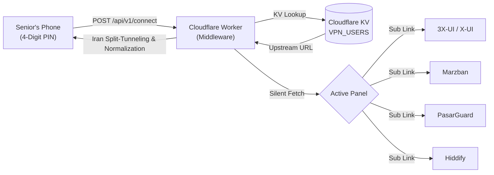

# 🌐 AsanVPN Panel Integration & Migration Guide

AsanVPN was built specifically so you can switch between **3X-UI, Marzban, PasarGuard, and Hiddify** behind the scenes without your customers ever needing to re-copy links, re-configure their phones, or change their 4-digit PIN.

---

## 1. Supported Panel APIs & Subscription Formats

| Panel | Auth / API Type | Subscription URL Format | Supported Protocols |
|---|---|---|---|
| **3X-UI / X-UI** (Sanaei / Alireza) | Session Cookie (`/login`) | `https://panel.domain/sub/{subId}` | VLESS, VMess, Trojan, Reality, Shadowsocks |
| **Marzban** | Bearer Token (`/api/admin/token`) | `https://panel.domain/sub/{token}` | VLESS, VMess, Trojan, Shadowsocks |
| **PasarGuard** | REST API & Sub Token | `https://panel.domain/sub/{token}` | VLESS, Reality, Trojan |
| **Hiddify** | Admin Secret & Sub Path | `https://panel.domain/{proxy-path}/{token}/` | VLESS, VMess, Trojan, Reality, Hysteria2 |
| **Raw / Generic** | Direct HTTP(S) | Any valid subscription link | Any Base64 or standard URI stream |

---

## 2. How the Pipeline Works



1. **Client Isolation**: The client app never knows the server's real IP or panel address. It only talks to your Cloudflare Worker.
2. **Dynamic Decoupling**: If an IP gets blocked by MCI/Irancell, you change the inbound/server in your panel. The next time the user taps "Connect", the Worker automatically serves the fresh config.
3. **Iran Domestic Bypass**: The Worker injects split-tunneling routing:
   - Domestic domains (`.ir`, `divar.ir`, `snapp.ir`, `torob.com`, `digikala.com`, etc.) bypass the tunnel directly.
   - Iranian banking apps (BluBank, Saman, Hamrah Card, Resalat, Mellat) route directly via `geoip:ir` so the senior never gets locked out of mobile banking.

---

## 3. Instant Domain & Panel Migration

### Scenario: Your Panel Domain Got Filtered by Telecommunications

When your panel domain `old-panel.com` is blocked:
1. Point a new domain or CDN to your panel: `new-panel.com`.
2. Send one command to the Telegram Admin Bot:
   ```bash
   /switch_domain old-panel.com new-panel.com
   ```
   Or via the CLI:
   ```text
   Choose option 6 -> Enter old domain -> Enter new domain -> Done.
   ```
3. Cloudflare KV automatically updates the upstream URLs for all active PINs in seconds.
4. **Result**: All your customers continue connecting seamlessly without any phone calls or support tickets!

### Scenario: Migrating from 3X-UI to PasarGuard or Marzban

If you migrate from 3X-UI to PasarGuard:
1. Export your clients or generate new sub links on PasarGuard with the same client tokens.
2. Run `/switch_domain xui.mydomain.com pasarguard.mydomain.com pasarguard` in Telegram.
3. The Worker adapts to the new format automatically.
